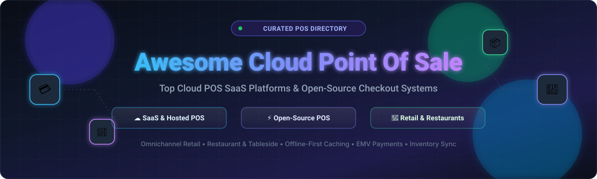
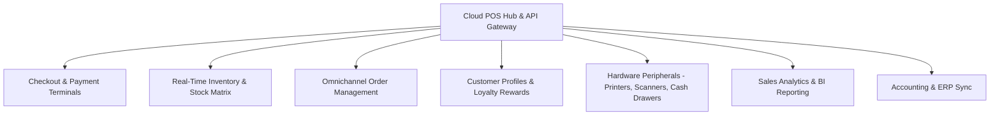

  

  
  
  
  
  
  

---

# 🛒 Awesome Cloud Point of Sale (POS) Systems 🚀

> **A comprehensive, SEO-optimized curated directory of top Cloud Point of Sale (POS) SaaS platforms and production-ready open-source POS systems for modern retail stores 🏬, restaurants 🍽️, multi-location franchises 🏢, and commerce developers 💻.**

Cloud Point of Sale (**POS**) platforms enable real-time checkout 💳, multi-channel inventory synchronization 📦, omnichannel order routing 🔄, contactless payments 📲, customer relationship management (CRM) 👥, and advanced sales analytics 📈 across distributed physical stores and digital storefronts.

Whether you are evaluating enterprise SaaS POS vendors ☁️ or deploying self-hosted, offline-first open-source POS engines ⚡, this directory tracks the leading solutions across the global point of sale landscape.

---

## 📑 Table of Contents

- [📊 Market Overview & Industry Dynamics](#-market-overview--industry-dynamics)
- [☁️ SaaS & Hosted Cloud POS Platforms](#️-saas--hosted-cloud-pos-platforms)
- [⚡ Open-Source POS Systems](#-open-source-pos-systems)
- [🧩 Core Cloud POS Architecture & Functional Modules](#-core-cloud-pos-architecture--functional-modules)
- [💡 How to Choose a Cloud POS System](#-how-to-choose-a-cloud-pos-system)
- [💖 Support & Sponsorship](#-support--sponsorship)
- [🤝 How to Contribute](#-how-to-contribute)
- [📈 Star History](#-star-history)
- [📜 Disclaimer](#-disclaimer)

---

## 📊 Market Overview & Industry Dynamics

> 🌐 **Estimated Market Size & Fragmentation:** The global cloud POS market was valued at approximately **$4.8 billion to $5.2 billion in 2023** and is projected to surpass **$18 billion by 2032** (CAGR ~15.2% 📈). The sector is **moderately fragmented** 🧩—while major fintech and enterprise giants (e.g., Salesforce, Shopify, Block/Square, Toast, Lightspeed, Fiserv/Clover) dominate major tier-1 and SMB segments, regional hardware-bundled solutions, specialized niche verticals (restaurants, pharmacies, grocery), and thriving open-source ecosystems prevent a singular winner-take-all outcome.

---

## ☁️ SaaS & Hosted Cloud POS Platforms

The table below catalogs leading commercial cloud POS platforms, sorted in descending order by **Company Size (Market Capitalization / Valuation / Annual Revenue)** 🏢. Specific entry-tier starting prices 💰 and exact free tier / free trial limits ⏱️ are explicitly detailed.

| Platform 🏷️ | Description & Key Strengths 🛠️ | Company Size (Valuation / Revenue) 💼 | Starting Pricing 💵 | Free Tier / Free Trial Limits 🎁 |
| :--- | :--- | :--- | :--- | :--- |
| **[Salesforce Retail Cloud POS](https://www.salesforce.com/solutions/retail/)** | Enterprise unified commerce POS delivering real-time shopper 360 data, AI-driven retail insights, cross-channel order orchestration, and native Salesforce CRM connection. | **~$280 Billion Market Cap** (Salesforce) / **~$34.9B+ Annual Revenue** | Starts at **$175/user/month** (Commerce Cloud Starter Edition; billed annually; custom enterprise pricing for high-volume store estates). | **30-day free trial** of Salesforce Commerce Cloud sandbox (includes pre-configured retail catalog, sample SKU inventory, and demo workflows; strictly non-production). |
| **[Shopify POS](https://www.shopify.com/pos)** | Industry-leading unified retail POS connecting physical store counters with online Shopify stores, centralized multi-location inventory, and integrated chip/tap card readers. | **~$105 Billion Market Cap** (Shopify) / **~$7.1B+ Annual Revenue** | Starts at **$39/month** (Basic plan includes Shopify POS Lite for basic checkout; Shopify POS Pro with advanced inventory & retail permissions adds **$89/month/location**). | **3-day free trial** without credit card, followed by promotional **$1/month for the first month** (full access to POS Lite checkout, inventory management, and web store). |
| **[Clover (Fiserv)](https://www.clover.com/)** | Full-stack retail and restaurant POS system combining custom cloud-connected proprietary smart terminals (Flex, Mini, Station) with an extensive merchant app market. | **~$75 Billion Market Cap** (Fiserv parent) / **~$19.1B+ Annual Revenue** | Starts at **$14.95/month** (Payments Plus software-only tier; Starter software+hardware bundles start from **$60/month for 36 months** or $1,699 upfront). | **30-day money-back satisfaction guarantee / trial window** on Clover hardware terminals; no perpetual free software tier. |
| **[Square for Retail (Block)](https://squareup.com/us/en/point-of-sale/retail)** | Modern cloud retail point of sale with instant merchant account onboarding, cross-location stock counts, barcode printing, vendor management, and built-in payment processing. | **~$40 Billion Market Cap** (Block, Inc.) / **~$21.9B+ Annual Revenue** | Starts at **$0/month** (Free plan; 2.6% + 10¢ per in-person tap/dip/swipe transaction; Retail Plus tier starts at **$89/month/location** for advanced multi-unit inventory). | **Perpetual Free Plan available** (Square Retail Free: covers 1 location, basic inventory tracking, in-person payment processing, digital receipts; no automated vendor purchase orders or cost-of-goods reporting). Plus plan offers a **30-day free trial**. |
| **[Toast POS](https://pos.toasttab.com/)** | Cloud restaurant management platform engineered specifically for food service, handheld tableside ordering, kitchen display systems (KDS), online ordering, and payroll. | **~$15 Billion Market Cap** (Toast, Inc.) / **~$3.9B+ Annual Revenue** | Starts at **$0/month upfront software** (Quick Start Bundle with pay-as-you-go processing rates; Core software subscription starts at **$69/month** for standard restaurant terminals). | **Pay-as-you-go Free Software tier** (Toast Quick Start: $0 recurring software subscription fee, hardware financed via higher payment processing fees; single-location operations). |
| **[Lightspeed Retail](https://www.lightspeedhq.com/pos/retail/)** | Advanced multi-outlet retail POS featuring complex inventory matrix variants, vendor catalogs, automated reorder triggers, serialized inventory, and loyalty rewards. | **~$2.5 Billion Market Cap** (Lightspeed Commerce) / **~$900M+ Annual Revenue** | Starts at **$89/month** (Basic plan billed annually; includes 1 register, inventory management, and Lightspeed Payments integration; Core tier starts at **$149/month**). | **14-day full-access free trial** (unlimited product imports, full register simulation, and analytics access; no credit card required). |
| **[Heartland Retail (Global Payments)](https://www.heartland.us/products/pos-systems/retail)** | Cloud point of sale and customer management platform tailored for mid-market multi-store apparel and specialty retail brands requiring distributed order management. | **~$22 Billion Market Cap** (Global Payments parent) / **~$9.7B+ Annual Revenue** | Starts at **$89/month/terminal** (software subscription billed annually; transaction fees vary per processing volume agreement). | **Custom guided interactive demo & 14-day pilot sandbox** for qualified multi-store retailers upon enterprise sales consultation. |
| **[Revel Systems](https://revelsystems.com/)** | iPad-based hybrid cloud architecture point of sale engineered for multi-location grocery stores, pizzerias, fast-casual restaurant chains, and high-volume retail franchises. | **~$600 Million Valuation** (Acquired by Shift4 / private enterprise) / **~$100M+ Annual Revenue** | Starts at **$99/month/terminal** (billed annually with a 2-year processing agreement requirement and Revel Advantage processing). | **Live interactive demo sandbox & 30-day trial period** upon pre-qualification by account executive; no public self-service free tier. |
| **[Vend by Lightspeed](https://www.lightspeedhq.com/pos/retail/vend/)** | Intuitive, responsive web & iPad POS for boutique retailers, craft stores, and specialty shops with offline resilience, cash management, and multi-outlet inventory transfer. | **~$2.5 Billion Market Cap** (Integrated into Lightspeed Commerce) / **~$900M+ Annual Revenue** | Starts at **$89/month** (Lightspeed Retail Standard edition, billed annually; covers 1 register and primary store location). | **14-day free trial** with access to sample inventory, barcode scanning simulation, and store reporting; no credit card required. |
| **[Erply POS](https://erply.com/)** | Enterprise-grade cloud POS and back-office ERP inventory engine with offline API sync, matrix inventory management, warehouse distribution, and gift card issuing. | **~$100 Million Valuation** (Bootstrapped / Private Growth Stage) / **~$30M+ Annual Revenue** | Starts at **$39/month** (POS Only tier, billed annually; Full POS + Back Office ERP plan starts at **$99/month/location**). | **14-day free trial** (unrestricted back-office dashboard, POS terminal emulator, customer loyalty database, and API testing; no credit card required). |

---

## ⚡ Open-Source POS Systems

Production-grade, community-supported, and self-hosted open-source Point of Sale systems sorted in descending order by **GitHub Star Count** ⭐:

1. **[Odoo](https://github.com/odoo/odoo)**   
   📦 *Python / JavaScript / PostgreSQL (LGPL-3.0)*  
   Comprehensive enterprise business suite with a fast, touch-friendly web-based POS app supporting offline browser caching, thermal receipt printing, barcode hardware scanners, restaurant table maps, and automated accounting ledger reconciliation.

2. **[ERPNext](https://github.com/frappe/erpnext)**   
   📦 *Python / JavaScript / MariaDB / Frappe Framework (GPL-3.0)*  
   Modern open-source ERP with a built-in Point of Sale module featuring real-time stock balance updates, customer loyalty points, serial and batch number selection, offline cashier caching, and automated sales invoice generation.

3. **[BTCPay Server](https://github.com/btcpayserver/btcpayserver)**   
   📦 *C# / .NET / ASP.NET Core (MIT)*  
   Self-hosted, open-source cryptocurrency payment processor featuring a built-in Point of Sale terminal app with custom keypad amounts, tipping, NFC/QR contactless checkout, and zero middleman fees.

4. **[Open Source Point of Sale (OSPOS)](https://github.com/opensourcepos/opensourcepos)**   
   📦 *PHP / CodeIgniter / MySQL / Bootstrap (MIT)*  
   Lightweight, web-based open-source point of sale application designed for small retailers with inventory management, sales receipts, customer profiles, barcode generation, and granular staff permissions.

5. **[NexoPOS](https://github.com/Blair2004/NexoPOS)**   
   📦 *PHP / Laravel / Vue.js / Tailwind CSS (GPL-3.0)*  
   Modular web and cloud POS platform built with Laravel and Vue.js, offering cash register management, order processing, multi-currency operations, stock tracking, and third-party extensions.

6. **[Store-POS](https://github.com/tngoman/Store-POS)**   
   📦 *JavaScript / Electron / React / SQLite (MIT)*  
   Modern Electron-powered desktop Point of Sale application featuring a fast React cash register, Express API, local-area network (LAN) multi-terminal sync, product photo catalogs, and receipt printing.

7. **[Lakasir](https://github.com/lakasir/lakasir)**   
   📦 *TypeScript / Vue.js / Nuxt / Tailwind CSS (GPL-3.0)*  
   Minimalist, lightweight open-source POS application designed for micro and small retail merchants seeking clean checkout interfaces without heavy back-office baggage.

8. **[TailPOS](https://github.com/bailabs/tailpos)**   
   📦 *Python / Kivy / SQLite (GPL-3.0)*  
   Offline-first mobile and desktop POS client designed to sync seamlessly with ERPNext, enabling uninterrupted retail checkout during internet outages and background data sync upon reconnect.

9. **[POS Awesome](https://github.com/ucraft-com/POS-Awesome)**   
   📦 *JavaScript / Vue.js / Vuetify (GPL-3.0)*  
   Modern and responsive single-page web Point of Sale application designed as an enhanced frontend for ERPNext, complete with offline cashier mode, fast keyboard shortcuts, and barcode reader compatibility.

10. **[Laravel POS](https://github.com/angkosal/laravel-pos)**   
    📦 *PHP / Laravel / Blade / MySQL (MIT)*  
    Clean, responsive web-based POS and inventory system created with Laravel, suitable for local shops, featuring order tickets, invoice printing, customer logs, and sales summaries.

11. **[React Point of Sale](https://github.com/shanmugharajk/react-point-of-sale)**   
    📦 *JavaScript / React / Node.js / Express (MIT)*  
    Developer-friendly full-stack cloud POS template showcasing a React client interface, real-time cart manipulation, order ticketing, and Node.js REST API persistence.

12. **[PHP Point of Sale](https://github.com/deenseth/PHP-Point-Of-Sale)**   
    📦 *PHP / MySQL / HTML5 (GPL-2.0)*  
    Straightforward, community-maintained web cashier system for tracking retail transactions, cash registers, account customer billing, and daily sales summaries.

13. **[URY ERP & POS](https://github.com/ury-erp/ury)**   
    📦 *Python / JavaScript / Frappe (GPL-3.0)*  
    Free and open-source restaurant management system and food-service POS engine powered by Frappe/ERPNext, supporting kitchen order tickets (KOT), tableside ordering, and recipe costings.

14. **[Aplikasi Point of Sales (React/Inertia)](https://github.com/aryadwiputra/point-of-sales)**   
    📦 *PHP / Laravel 11 / Inertia.js / React / Tailwind CSS (MIT)*  
    Modern full-stack Point of Sale application built with Laravel, Inertia.js, and React, providing quick product indexing, transaction reporting, and sleek modern UI aesthetics.

15. **[Go POS API](https://github.com/bagashiz/go-pos)**   
    📦 *Go / Gin / PostgreSQL / Redis (MIT)*  
    Production-grade RESTful POS backend microservice crafted in Go using hexagonal architecture, PostgreSQL data persistence, Redis caching, and high-concurrency checkout throughput.

---

## 🧩 Core Cloud POS Architecture & Functional Modules

Modern cloud point of sale systems replace legacy on-premises cash registers with distributed, cloud-synced microservices:

- 💳 **Checkout & Payment Terminals:** Support for EMV chip cards, contactless NFC (Apple Pay, Google Pay), manual key-in, split bills, tips, and gift cards.
- 📦 **Inventory & Stock Management:** Centralized multi-location catalog, automated low-stock warnings, purchase order reorders, barcode/SKU labeling, and serialized items.
- 🌐 **Omnichannel Order Routing:** Real-time synchronization connecting in-store purchases, Click & Collect (BOPIS - Buy Online, Pick Up In Store), and curbside fulfillment.
- 👥 **Customer Loyalty & CRM:** Transaction history, points collection, tiered rewards programs, targeted SMS/email marketing, and credit accounts.
- 🖨️ **Hardware Device Integration:** Esc/POS thermal printers, barcode scanners (USB/Bluetooth), customer-facing secondary displays, and cash drawers.
- 📊 **Executive Analytics & Reporting:** Real-time register balancing, end-of-day X/Z reports, gross margin calculations, staff shift performance, and tax exports.

---

## 💡 How to Choose a Cloud POS System

When deciding between a commercial SaaS POS and an open-source solution, consider these core trade-offs:

1. 🖥️ **Hardware Ecosystem & Lock-in:** Commercial platforms like Clover and Toast often require proprietary terminals with bundled processing rates. Open-source or software-only systems (such as Odoo POS or NexoPOS) run on generic iPads, Android tablets, touch monitors, or standard PCs.
2. 💳 **Payment Processing Fees:** Compare fixed monthly subscription fees against swipe rates (e.g., 2.6% + 10¢ vs. interchange-plus). For high transaction volumes, software with processing-agnostic gateways saves significant capital.
3. 📶 **Offline Resilience:** If your internet connection is unstable, ensure the POS supports local offline transaction caching (like Odoo POS or TailPOS) that transparently syncs back to the cloud when reconnected.
4. 🔐 **Data Sovereignty & Customization:** Open-source architectures grant full access to underlying SQL databases and APIs, making them ideal for custom workflows, regulatory data residency, and avoiding vendor price hikes.

---

## 💖 Support & Sponsorship

If this curated directory has helped you explore, evaluate, or architect cloud Point of Sale solutions, please consider supporting the project! 🌟

- ⭐ **Star this repository** to help others discover it across GitHub.
- 🍴 **Fork and contribute** new open-source projects, SaaS insights, or documentation updates.
- 📢 **Share** with fellow engineers, retail operators, and restaurant managers.
- ☕ **Buy a Coffee / Sponsor:** If you'd like to support ongoing curation and open-source research, check out the [GitHub Sponsors Dashboard](https://github.com/sponsors/ishandutta2007). Thank you so much for your generosity! 🚀

---

## 🤝 How to Contribute

Community additions, corrections, and new platforms are warmly welcomed! 🎉

1. 🍴 Fork the repository.
2. 🌿 Create your feature branch (`git checkout -b feature/add-new-pos`).
3. 📝 Update `README.md` following the established table structure, exact pricing/trial limits, and GitHub badges.
4. 🚀 Commit your changes (`git commit -m "Add New POS Platform"`).
5. 📬 Open a Pull Request detailing your additions.

---

## 📈 Star History

---

## 📜 Disclaimer

- ℹ️ This directory is **community-curated** for educational, evaluation, and research purposes.
- 🏢 All product names, logos, and brands are property of their respective owners.
- ⚠️ SaaS pricing, features, and trial limits are subject to change by vendors. Verify current terms on official websites prior to contract signing.

---

  Curated with ❤️ for Retailers, Restaurateurs, Store Operators, and Commerce Engineers worldwide.

